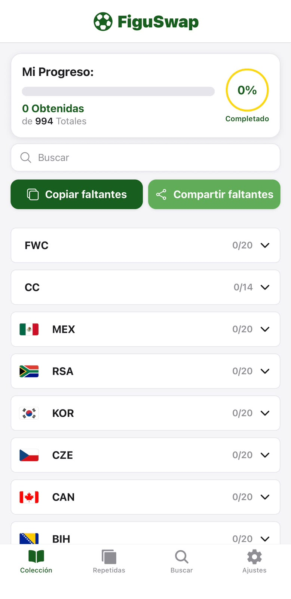
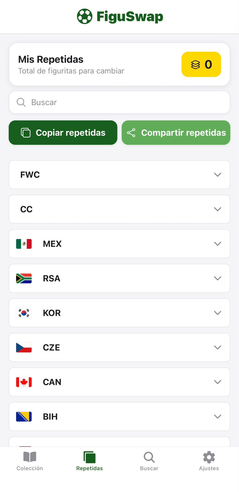
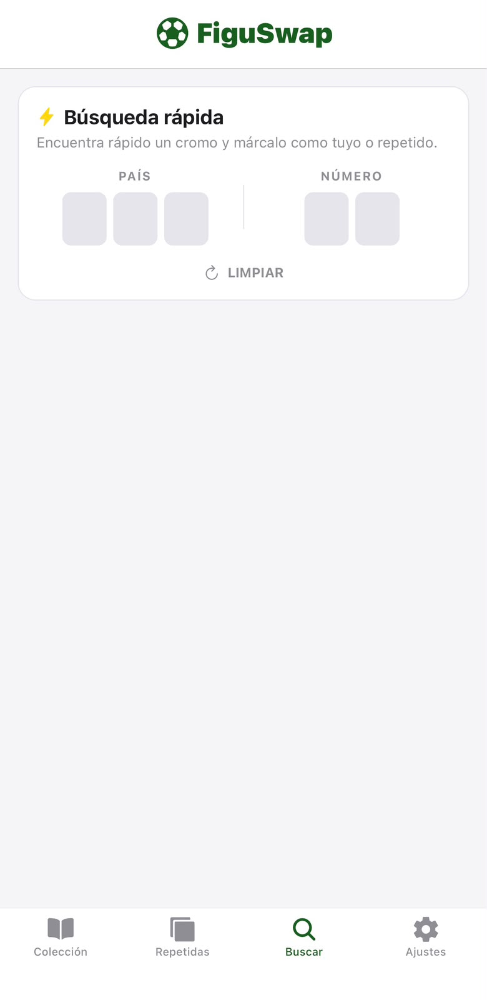

# Álbum Mundial 2026 - Sticker Tracker

Aplicación móvil desarrollada con **React Native y Expo** para llevar el control del álbum de figuritas del Mundial 2026. Permite gestionar de forma rápida qué figuritas ya están pegadas, cuáles faltan y llevar la cuenta de las repetidas para facilitar los intercambios.

## ✨ Funcionalidades

- **Control de progreso:** Visualización del porcentaje total completado del álbum y conteo por selección o sección.
- **Gestión de estados:** Marcado rápido de figuritas (Obtenida / Faltante).
- **Contador de repetidas:** Control de cantidad de duplicadas para tener a mano al momento de cambiar.
- **Almacenamiento local:** Todos los datos y avances se guardan directamente en la memoria interna del dispositivo, permitiendo usar la app sin conexión a internet.

## 📱 Capturas de pantalla

|          Pantalla Principal          |                 Mis Repetidas                  |                  Buscar                  |
| :----------------------------------: | :--------------------------------------------: | :--------------------------------------: |
|  |  |  |

## 🛠️ Tecnologías utilizadas

- [React Native](https://reactnative.dev/)
- [Expo](https://expo.dev/) (Expo Router)
- TypeScript / JavaScript
- Almacenamiento local en el dispositivo (Local Storage / AsyncStorage)

## 🚀 Cómo ejecutar el proyecto localmente

### Prerrequisitos

- Tener instalado [Node.js](https://nodejs.org/) (versión LTS recomendada).
- Tener instalada la app **Expo Go** en tu celular (disponible en Android e iOS) o un emulador configurado en tu PC.

### Instalación

1. Install dependencies

   ```bash
   npm install
   ```

2. Start the app

   ```bash
   npx expo start
   ```

3. Abrir la aplicación:
   En tu celular: Escaneá el código QR que aparece en la terminal usando la app Expo Go.
   En emulador: Presioná a en la terminal para abrir en Android Studio o i para abrir en el simulador de iOS.

### Próximas mejoras (Roadmap)

- Implementación de base de datos en la nube para sincronizar el progreso entre dispositivos.

- Autenticación de usuarios.

- Exportar lista de faltantes y repetidas en formato texto para compartir por WhatsApp.

- Buscador avanzado por nombre de jugador y filtro por selección.
